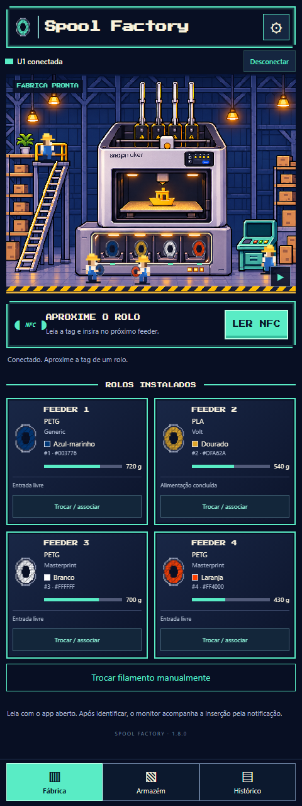
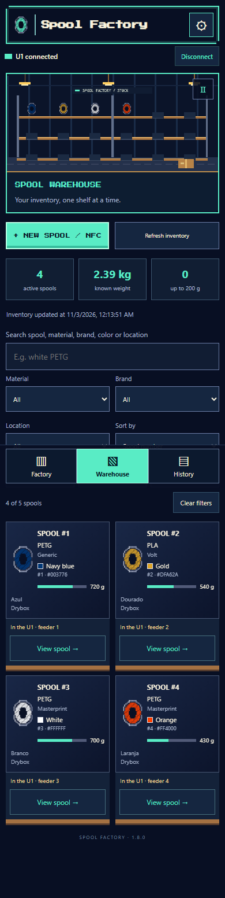
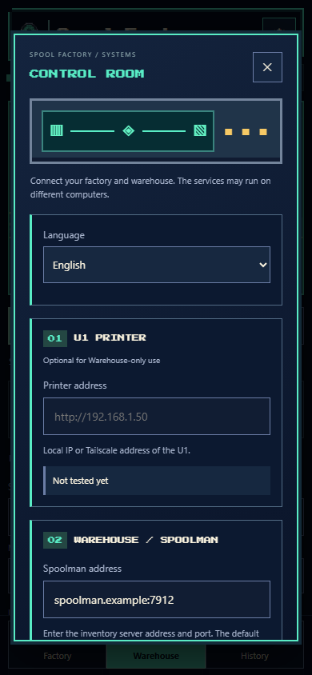

# Spool Factory

**Turn your Android phone into an external NFC spool reader for the Snapmaker U1.**

[Download APK](https://github.com/caiotmoraes/spool-factory/releases/download/v1.8.0-beta.1/Spool-Factory.apk) · [Website](https://caiotmoraes.github.io/spool-factory/) · [Português](README.pt-BR.md) · [Report a bug](https://github.com/caiotmoraes/spool-factory/issues)

## What it does

- Reads an NFC tag's UID using your phone and finds its registered spool in Spoolman.
- Waits for the **next U1 feeder that receives filament**, then associates the scanned spool with that feeder. No feeder selection is needed in automatic mode.
- Shows the four feeder states, material, brand, colors and remaining spool weight when available.
- Offers **manual spool selection, association, load and unload** through the U1's native commands, with explicit confirmation.
- Includes a pixel-art **Warehouse** with material/brand/location filters, low-stock view, spool details and compact layout, plus a searchable local history office.
- Registers new spools in Spoolman from an NFC scan, showing an existing spool (including archived ones) before allowing a new registration. Choose a catalog filament or create a manufacturer and filament definition, including multiple colors.
- Adds NFC tags to an existing spool and edits weight, location and notes. Permanent spool deletion requires the exact spool number and preserves the manufacturer/filament catalog.
- Provides a themed **Control Room** with separate printer/Spoolman connection tests and optional API keys. The Warehouse can be used with Spoolman alone, without connecting a printer.
- Uses an offline pixel-art factory interface with animated workers, a pause button and a layout for folded/unfolded screens.

Designed for spools in a drybox below the printer, or as an alternative to reading tags at the built-in readers.

## Requirements

| Component | Requirement |
|---|---|
| Phone | Android 8.0+ with NFC; UI in English and Brazilian Portuguese |
| Printer | Snapmaker U1 with compatible **PAXX12 Extended Firmware + SpoolLink** |
| Inventory | A reachable Spoolman deployment; tags registered in `extra.card_uids` |
| Network | Phone can reach both services through a trusted LAN **or your own VPN/Tailscale** |

Stock Snapmaker firmware is not supported. The integration was developed against the PAXX12 2.0.0-paxx12-24 series; it requires the external-reader `/printer/filament_detect/set` and `/printer/spoollink/set` interfaces, feeder status objects and the native `AUTO_FEEDING` macro. Other firmware versions require validation. No ACR122U, USB reader, custom firmware fork or root access on the phone is needed.

The app does **not** install Spoolman, change your firmware, provision Tailscale or give access to someone else's printer.

## Required reader mode

Before using phone-based association, open the U1's Firmware Config and select **Filament Detection → External**. This stops OpenRFID's internal-reader updates that could erase phone-assigned spool identities during loading. The firmware applies this setting by restarting Klipper: change it only with the printer idle and no feeder operation running. The app verifies this setting before writing; it does not change firmware settings automatically.

Version 1.4 removes background metadata repairs/clears and discards historical identity references created by earlier versions on its first start. Physical presence is shown separately from a leftover configured spool ID. Load/unload still require confirmation and an idle U1.

## Install and configure

1. Download **Spool-Factory.apk** from the [release](https://github.com/caiotmoraes/spool-factory/releases/tag/v1.8.0-beta.1) to your phone and open it. Allow installation from your browser/file manager when Android asks.
2. Open the app. The connection settings appear on first use. There are **no preconfigured printer IPs or accounts**.
3. Enter your **U1 address** and **Spoolman address**. Examples: `192.168.1.50` and `http://spoolman.local:7912`. Bare IPs/hostnames are accepted; an explicit `https://` address is preserved. Use the actual port for your deployment.
4. Enter API keys if your deployments require them. Tap **Testar**, then **Salvar**.
5. If using Tailscale, install/sign in to Tailscale separately on your phone and use your own devices' addresses. Otherwise, use your local Wi-Fi network.
6. Tap **Conectar**. Enable NFC for scanning and allow the monitor notification. The gear icon reopens configuration at any time.

## Automatic workflow

1. With the app open, tap the spool tag against the phone.
2. Wait until the app identifies the spool and asks you to insert the filament.
3. Insert filament into **one** free feeder. The app observes a new insertion, waits for preload to finish and submits the tag UID through the external-reader interface.
4. Wait for confirmation of the correct spool ID and UID returned by the U1.

An unknown/archived/duplicated tag, simultaneous feeder insertions, a timeout or a lost connection will not be reported as a successful association. The app reads UIDs; it does not write tags.

## Manual workflow

Open **Trocar / associar** on a feeder card:

1. Select the feeder and use **Retirar filamento** to unload the old filament, if needed.
2. After completion, remove the old filament and insert the new one. Wait for preload to finish.
3. Select the matching active spool from inventory and tap **Associar rolo ao feeder**.
4. Use **Carregar filamento** if you want the U1 to load it into the toolhead.

Each operation asks for confirmation on the phone. Load/unload may heat the nozzle and move the printer. Controls are blocked during printing, pause, errors, a pending association or another feeder operation. A network timeout does not trigger an automatic motor retry. Disconnecting the monitor does not stop a command already accepted by the U1.

## Identity and missing data

Some firmware events clear per-channel metadata to `NONE`, spool ID zero and default white while filament remains present. The app treats these as missing data, not as a real white spool. It can resolve a live UID through Spoolman or retain a confirmed association for the same continuous insertion.

After a restart or lost connection, a historical association is marked **Última associação · confirme o rolo**. It is a reference, not proof of the currently installed spool. Confirm it manually or scan again. A detected removal or another tag invalidates that reference. Unavailable color/weight is shown as unknown, never fabricated. Color names are approximate; hexadecimal values preserve the source color.

## Release status and limitations

This is an **early public beta**. The interface and integration have automated regression coverage. NFC association has been used on a Galaxy Z Fold7 in the original deployment. The latest public setup flow and physical load/unload controls still need wider device/hardware validation. Do not interpret desktop simulation tests as hardware certification.

Keep the monitor and network connection active during changes. NFC reading requires the app to be visible; after identification, the foreground monitor can continue via its notification. There is no automatic start after reboot. Check [PRIVACY.md](PRIVACY.md) before sharing diagnostics.

## Development and license

[Build and test](BUILDING.md) · [Contributing](CONTRIBUTING.md) · [Privacy](PRIVACY.md) · [MIT license](LICENSE) · [Third-party notices](THIRD_PARTY_NOTICES.md)

Private signing keys, API keys and actual deployment addresses are not included. Official releases and locally compiled development builds use different signing keys unless you supply your own release key.

Inspired by the external-reader workflow in [U1-ACR122U](https://github.com/DnG-Crafts/U1-ACR122U), using the [Extended Firmware external RFID contract](https://github.com/paxx12-snapmaker-u1/SnapmakerU1-Extended-Firmware/blob/develop/docs/design/filament_detect.md) and [Spoolman](https://github.com/Donkie/Spoolman). This is an independent community project.

## Warehouse and NFC registration

Open **Armazém → Novo rolo / NFC**. Scan a tag: the app queries Spoolman and shows its existing spool, or marks the tag free after a successful lookup. Existing/archived/conflicting bindings block a duplicate registration. NFC provides a UID; it does not automatically identify the material or color of an arbitrary tag and the app does not rewrite the tag.

Select an existing filament or enter manufacturer, name/finish, material, up to five HEX colors, density and diameter. Enter initial/remaining **net filament weight** (without the empty spool), location and notes, then confirm saving. The app uses the SpoolLink-compatible text field `extra.card_uids`, creating the definition if needed. Existing tags and unrelated extra fields are preserved when adding a tag.

In a spool's details, edit its weight/location/notes, add NFC, choose a feeder, or delete that spool. Leave the edit weight blank to preserve live consumption. Deletion asks for its exact number and is blocked for a spool still indicated in a feeder or pending association in the last U1 state received. The app does not know other printers' assignments. Deletion is permanent in Spoolman; it leaves the manufacturer and filament definition intact.

Legacy Spoolman does not provide one transaction for manufacturer + filament + spool creation, nor a cross-client uniqueness lock for the custom UID field. After a network failure, refresh and inspect the stock before repeating. Writes are not retried automatically.

## More views

Screenshots below use illustrative inventory and connection addresses.

 

## Language

Version 1.8 adds **English and Brazilian Portuguese**, including native confirmations, notifications, app status/error messages and local history display. Automatic mode follows the phone: Portuguese locales use Portuguese and other languages fall back to English. Choose **gear → Language → English / Português (Brasil) / Automatic → Save** to override it. Closing settings without saving cancels the language preview.

Spoolman names, brands, locations, notes, spool IDs and NFC UIDs are preserved as registered. A language-only settings save keeps the printer connection and pending assignment. Arbitrary server/firmware responses remain in their original language. Original stored history dates stay as recorded.

See [TRANSLATING.md](TRANSLATING.md) for the shared translation catalog and tests.
