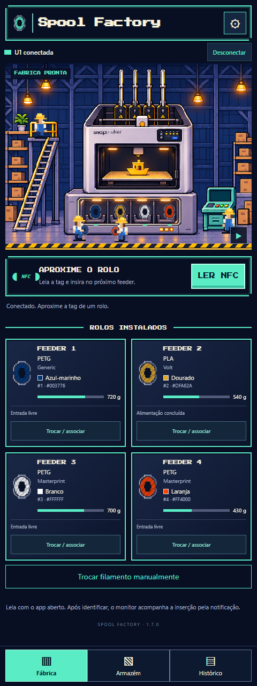
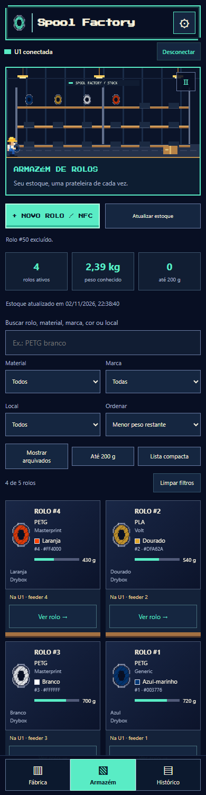
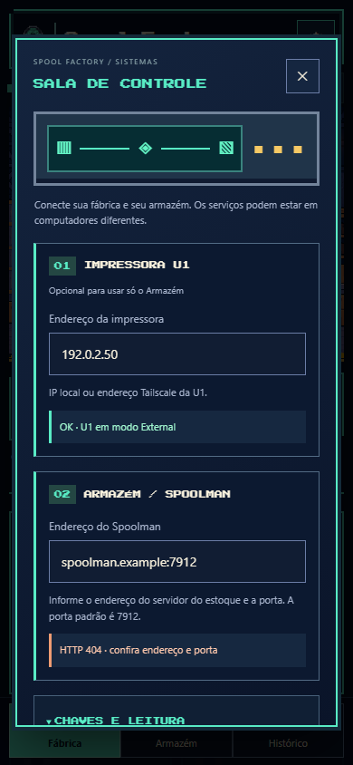

# Spool Factory

**Seu celular Android como leitor NFC externo para a Snapmaker U1.**

[Baixar APK](https://github.com/caiotmoraes/spool-factory/releases/download/v1.7.0-beta.1/Spool-Factory.apk) · [Página do projeto](https://caiotmoraes.github.io/spool-factory/) · [English](README.md) · [Relatar problema](https://github.com/caiotmoraes/spool-factory/issues)

## Para que serve

Leia a tag do rolo pelo celular, aguarde a identificação e insira o filamento em um feeder livre. O aplicativo detecta qual entrada foi ativada, espera terminar a alimentação e associa o rolo àquele feeder. É útil para rolos em drybox e para dispensar a leitura nos leitores internos.

Também inclui escolha manual do rolo/feeder, associação, carregar/retirar filamento, cores e saldo dos rolos, estoque pesquisável, filtro de arquivados e histórico. O visual é uma fábrica em pixel art com uma U1 e trabalhadores animados.

## O que você precisa

- Celular Android 8.0+ com NFC. A interface está em português brasileiro.
- Snapmaker U1 com **PAXX12 Extended Firmware e SpoolLink** compatíveis; firmware original da Snapmaker não é suportado.
- Spoolman acessível e tags cadastradas em `extra.card_uids`.
- Celular com acesso à U1 e ao Spoolman por rede local **ou sua própria VPN/Tailscale**.

O desenvolvimento usou a série 2.0.0-paxx12-24. São necessárias as interfaces externas `/printer/filament_detect/set`, `/printer/spoollink/set`, os estados dos feeders e a macro `AUTO_FEEDING`. Outras versões precisam ser validadas. O app não instala firmware, Spoolman ou Tailscale. Não exige ACR122U, leitor USB nem root.

## Modo obrigatório: leitor externo

No Firmware Config da U1, selecione **Filament Detection → External**. Isso interrompe as atualizações dos leitores internos/OpenRFID que podiam apagar a associação feita pelo celular durante o carregamento. A mudança reinicia o Klipper: faça apenas com a impressora ociosa e sem operação nos feeders. O aplicativo verifica esse modo antes de gravar; não muda essa configuração automaticamente.

A versão 1.4 remove regravações/limpezas automáticas em segundo plano e descarta referências antigas das versões anteriores no primeiro uso. Uma entrada fisicamente vazia não aparece como rolo instalado só por ter um ID antigo configurado.

## Instalar e configurar os IPs

1. Baixe **Spool-Factory.apk** na [release pública](https://github.com/caiotmoraes/spool-factory/releases/tag/v1.7.0-beta.1) e abra o arquivo no celular.
2. Autorize a instalação pelo navegador/gerenciador quando o Android solicitar.
3. Ao abrir, a configuração aparece automaticamente: **nenhum IP ou conta vem preenchido**.
4. Informe o endereço da **sua U1** e do **seu Spoolman**. Exemplos: `192.168.1.50` e `http://spoolman.local:7912`. IP sem `http://` também funciona. Use a porta real do seu serviço.
5. Informe chaves de API se forem exigidas. Toque em **Testar**, depois **Salvar** e **Conectar**. A engrenagem reabre essas opções.
6. Ative o NFC para ler tags e permita a notificação do monitor. Se usar Tailscale, configure sua conta e seus dispositivos separadamente no aplicativo Tailscale.

## Associação automática

Com o app aberto, aproxime a tag da traseira do celular. Aguarde **Rolo identificado. Insira o filamento no feeder desejado.** Insira em uma única entrada livre e espere **Associado ao feeder N**. O aplicativo verifica o ID do rolo e o UID retornados pela U1.

Tag desconhecida, arquivada ou duplicada, duas entradas ativadas, prazo encerrado ou conexão perdida geram uma orientação de correção, sem anunciar sucesso. Uma nova leitura substitui a espera anterior. A tag não é regravada.

## Troca manual

Toque em **Trocar / associar** no feeder:

1. Se necessário, use **Retirar filamento** no feeder escolhido e aguarde a conclusão.
2. Remova o antigo, insira o novo e aguarde a alimentação inicial terminar.
3. Escolha o rolo ativo no estoque e toque em **Associar rolo ao feeder**.
4. Use **Carregar filamento** para carregar no cabeçote.

Cada ação pede confirmação no celular. Os comandos podem aquecer o bico e movimentar a impressora. Ficam bloqueados durante impressão/pausa, erro, associação pendente ou outra operação. Não há repetição automática de movimentos após uma falha de rede. Desconectar não interrompe um comando que a U1 já recebeu.

## Identificação incompleta

O firmware pode apagar metadados de um canal para `NONE`, ID zero e branco padrão, embora o filamento permaneça inserido. O aplicativo trata isso como informação ausente e busca os dados do rolo pelo ID/UID quando possível. Uma associação confirmada pode ser mantida para a mesma inserção contínua.

Após reinício ou conexão perdida, uma referência antiga aparece como **Última associação · confirme o rolo**. Não é confirmação do rolo físico atual: associe manualmente ou leia novamente. Retirada detectada ou outra tag invalidam a referência. Cores e saldos ausentes não são inventados; o nome da cor é aproximado e o hexadecimal mantém o valor original.

## Beta, privacidade e ajuda

Esta é uma **beta pública inicial**. Há testes de lógica, HTTP simulado e interface. A associação NFC foi utilizada em um Galaxy Z Fold7 na instalação original; a configuração pública e os comandos físicos novos ainda precisam de validação mais ampla. Testes no computador não certificam o hardware.

Mantenha o monitor e a rede ativos durante a troca. NFC exige o app aberto; depois da identificação, a notificação mantém o acompanhamento. Não inicia sozinho após reiniciar o celular. O estoque salvo mostra a data da consulta.

[Privacidade](PRIVACY.md) · [Compilar](BUILDING.md) · [Contribuir](CONTRIBUTING.md) · [Licença MIT](LICENSE) · [Créditos](THIRD_PARTY_NOTICES.md)

Não publique chaves de API, IPs privados, UIDs ou diagnósticos sem revisão nas issues. O repositório e o APK não incluem a rede, conta ou endereço de impressora do autor.

## Cadastro NFC no Armazém

No **Armazém → Novo rolo / NFC**, leia a tag para consultar o Spoolman. O app informa se a tag está livre ou já identifica um rolo, incluindo arquivados, e bloqueia duplicatas. Escolha um filamento do catálogo ou cadastre fabricante, material, nome, cores, densidade e diâmetro. Informe peso líquido inicial/restante e local; confirme para salvar. Na ficha do rolo, é possível adicionar outra tag ou corrigir peso, local e observações.

O Armazém pode funcionar só com o endereço do Spoolman, sem a impressora conectada. A associação a feeders continua específica da U1/paxx12. Ler NFC não descobre automaticamente material/cor de qualquer etiqueta e não grava conteúdo nela. Consultas falhas não são tratadas como tag livre.

O Spoolman legado não oferece uma transação única para criar fabricante, filamento e rolo. Se a rede falhar, confira o estoque antes de repetir. Não há repetição automática de escritas nem transferência silenciosa de tags entre rolos. A verificação de duplicidade é preventiva e não bloqueia alterações simultâneas feitas por outros clientes.

## Sala de Controle e exclusão

A engrenagem abre a **Sala de Controle**, no visual pixel art, com testes independentes da U1 e do Spoolman. IPs, portas e chaves são configuráveis; chaves opcionais ficam na seção recolhida. O teste apenas consulta os serviços, sem mover a impressora.

Para excluir um rolo, use **Armazém → Ver rolo → Excluir rolo do Spoolman** e digite o número exato na confirmação. É definitivo para esse cadastro e seus vínculos NFC; fabricante e tipo de filamento permanecem no catálogo. A exclusão fica bloqueada se o último estado recebido da U1 indicar o rolo em um feeder ou associação pendente. Retire o filamento e atualize a leitura antes de excluir; o app não conhece associações de outras impressoras.

 
